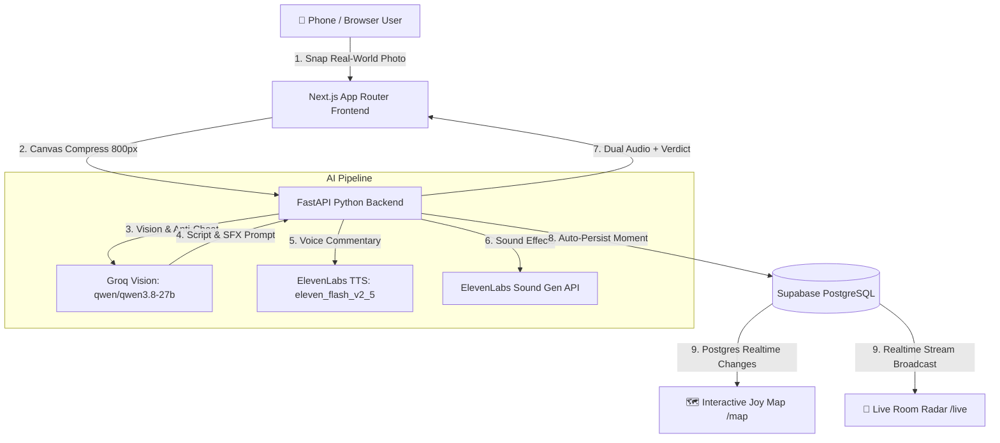

# 🌱 TouchGrass: Joy Radar
> **Touch Grass. Find Joy. Get Narrated Live.**  
> *Built for MLH Hacktoberfest x ElevenLabs Hackathon*

---

## 🏆 Project Overview

Modern developers and students spend 12+ hours a day glued to IDEs and social feeds, starved of physical-world serotonin. **TouchGrass: Joy Radar** turns real-world offline moments into high-dopamine social gaming.

Users pick micro-quests (touching physical grass, savoring a hot masala chai, spotting a neighborhood dog), snap a photo, and get **instant AI vision verification** paired with **real-time ElevenLabs voice commentary** layered over **generative sound effects**. Genuine moments trigger confetti and drop onto a live, shared **Supabase Realtime Joy Map** and **Big-Screen Projector Wave** (`/live`).

---

## ⚡ Key Innovations

1. **AI Vision & Anti-Cheat Screen Detection (Groq LPU)**:
   - Uses `qwen/qwen3.8-27b` on Groq to inspect photos for pixel moiré patterns, screen glares, and monitor bezels.
   - If a user tries to photograph a Google Image on their MacBook screen, they get flagged (`isCheat = true`) and ruthlessly roasted in character!
2. **Dual-Layered ElevenLabs Audio Engine**:
   - **TTS Commentary**: In-character narration synthesized via ElevenLabs (`eleven_flash_v2_5`) using distinct personas (IPL Commentator, Sir David Attenborough, Warm Bestie, Savage Roast Master).
   - **Sound Effects (SFX)**: Dynamic 4-second environmental audio generated via the ElevenLabs Sound Generation API (`/v1/sound-generation`).
3. **Real-Time Joy Map & Big-Screen Projector (`/live`)**:
   - Interactive Leaflet map with custom neo-brutalist pins dropping in real time via Supabase Realtime.
   - Projector dashboard featuring an **Audience QR Code**, real-time audio queue, and a **"Summarize Room Mood" Grand AI Finale**.
4. **Hacktoberfest Open-Source Architecture**:
   - Zero-friction open-source expansion: anyone can submit a PR adding localized quests or new voice personas via clean JSON files in `src/data/`.

---

## 📐 System Architecture



---

## 🛠️ Tech Stack

- **Frontend**: Next.js (App Router, pure JavaScript), Tailwind CSS, Leaflet, `canvas-confetti`, `lucide-react`, `qrcode.react`.
- **Backend**: Python FastAPI, Uvicorn, `groq` SDK, `requests`, `python-dotenv`, `pydantic`, `supabase-py`.
- **AI & Audio Engine**: Groq Vision (`qwen/qwen3.8-27b`), ElevenLabs Text-to-Speech (`eleven_flash_v2_5`), ElevenLabs Sound Generation (`/v1/sound-generation`).
- **Database & Realtime**: Supabase Database with Realtime publication enabled.

---

## 🚀 Quick Start

### 1. Prerequisites
- Python 3.10+
- Node.js 18+

### 2. Backend Setup
```bash
cd backend
pip install -r requirements.txt
```

Create `backend/.env`:
```env
GROQ_API_KEY=your_groq_api_key
ELEVENLABS_API_KEY=your_elevenlabs_api_key
SUPABASE_URL=your_supabase_url
SUPABASE_SERVICE_KEY=your_supabase_service_or_anon_key
```

Run FastAPI server:
```bash
python -m uvicorn main:app --reload --port 8000
```

### 3. Frontend Setup
```bash
cd frontend
npm install
```

Create `frontend/.env.local`:
```env
NEXT_PUBLIC_SUPABASE_URL=your_supabase_url
NEXT_PUBLIC_SUPABASE_ANON_KEY=your_supabase_anon_key
NEXT_PUBLIC_API_URL=http://localhost:8000
```

Run Next.js dev server:
```bash
npm run dev
```

Open:
- **Snap Joy Moment**: `http://localhost:3000`
- **Interactive Joy Map**: `http://localhost:3000/map`
- **Live Room Projector**: `http://localhost:3000/live`

---

## 🎃 Hacktoberfest Contributions

We welcome open-source contributions! You can easily add:
1. **New Quests** in `frontend/src/data/quests.json`
2. **New Narrator Personas** in `frontend/src/data/personas.json`

See [CONTRIBUTING.md](./CONTRIBUTING.md) for full instructions and sample schemas.
