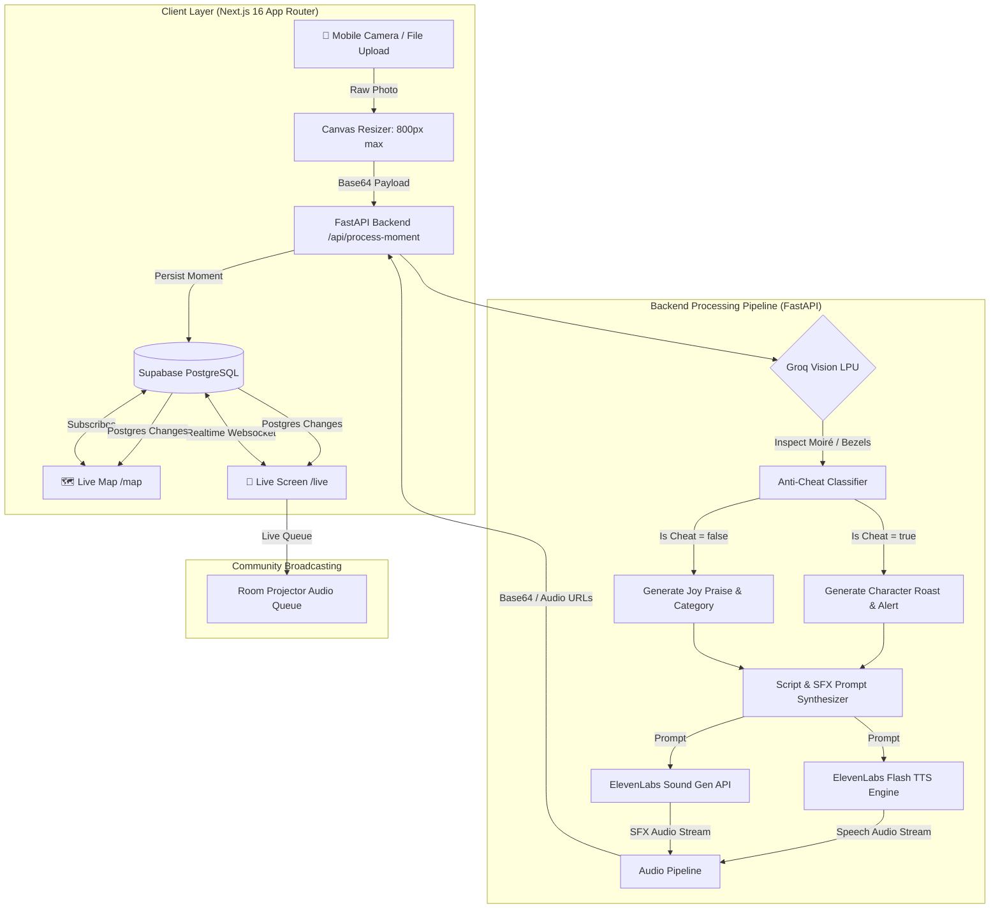

# 🌱 TouchGrass: Joy Radar

<div align="center">


<br/>

**Step away from the screen. Touch real grass. Get narrated live by AI.**  
*An AI-powered offline wellness game, anti-cheat vision engine, and real-time community joy radar.*

[-black?style=flat-square&logo=next.js)](https://nextjs.org/)
[-009688?style=flat-square&logo=fastapi)](https://fastapi.tiangolo.com/)
[](https://groq.com/)
[](https://elevenlabs.io/)
[](https://supabase.com/)
[](https://tailwindcss.com/)
[](./CONTRIBUTING.md)

[Features](#-key-features) • [Architecture](#-system-architecture) • [Demo Walkthrough](#-application-tour) • [Judging Criteria](#-why-touchgrass-wins) • [API & Schema](#-api--schema-reference) • [Quick Start](#-getting-started) • [Deployment](#-deployment-guide)

</div>

---

## 💡 The Problem vs. The Solution

| The Digital Trap 📱 | The TouchGrass Remedy 🌿 |
| :--- | :--- |
| **12+ hours of screen fatigue:** Students and engineers spend continuous hours trapped in IDEs, Zoom calls, and infinite social doomscrolling. | **Gamified physical reconnection:** Turns stepping away from the desk into an instant, high-dopamine quest doable in under 60 seconds. |
| **Cheating & fake uploads:** Users in wellness apps frequently cheat by photographing desktop monitor wallpapers or Google search results. | **Hardware-grade anti-cheat:** Groq Vision inspects bezel reflections, pixel moiré, and digital glares; screen cheaters are detected and roasted in character! |
| **Boring static notifications:** Generic badges and notification pings get ignored after day one. | **Immersive AI narration & SFX:** Dual-engine audio combines personalized character voice commentary with synced environmental audio. |
| **Isolated habit trackers:** Most wellness apps are lonely single-player spreadsheets. | **Realtime community joy map:** Live Leaflet radar and projector screens celebrate offline moments with live pins, confetti, and room mood analytics. |

---

## ⚡ Key Features

### 1. Dual Game Modes
- **🌿 Touch Grass Mode:** AI dynamically generates ultra-simple, spontaneous physical offline challenges using common surrounding objects (e.g., *"Touch rough tree bark"*, *"Find a steaming hot chai cup"*, *"Look up at open clouds"*). Includes a one-click AI re-roll if a task isn't possible right now.
- **📷 Snap a Moment Mode:** Spontaneous offline moments captured freely. The AI dynamically evaluates the photo's content, sensory tone, and atmosphere, pins it to the community map, and writes a contextual commentary.

### 2. Groq Vision Anti-Cheat Engine (LPU Speed)
- Powered by high-throughput vision inference via Groq Cloud (`llama-3.2-11b-vision-preview` / `llama-3.2-90b-vision-preview`).
- Analyzes photos for physical depth, lighting authenticity, and monitor bezel artifacts:
  - **Authentic Offline Moments:** Categorized into Nature, Food, Social, or Small Wins with confetti and praise.
  - **Screen Cheaters Caught in 4K:** Triggers a prominent red anti-cheat stamp and a hilarious, customized roast in the selected persona's voice!

### 3. Dual-Layered Generative Audio Engine (ElevenLabs)
- **Voice Commentary:** Synthesizes high-fidelity character voices with zero latency.
  - **Featured Lead Voice:** **Sarang - Funny, Optimistic and Inviting** — a warm, articulate, and confident tone that encourages users to unwind without pressure.
  - **Dynamic Personas:** IPL Commentator, Sir David Attenborough, Cozy Bestie, and Drama Queen.
- **Generative Environmental Sound Effects:** Generates custom 4-second environmental audio clips matching the photo context (e.g., sizzling chai, forest wind, rustling grass, or celebratory whistles) using the ElevenLabs Sound Generation API.

### 4. Interactive Live Joy Radar Map (`/map`)
- Custom-themed dark Leaflet cartography tracking authentic offline moments worldwide.
- **Custom Vector Markers:** Color-coded SVG icons for each category.
- **Audio Drawer:** Click any pin to view the Polaroid, inspect GPS coordinates, and replay the voice commentary.
- **Persistent Quick-Access Action:** A floating Touch Grass button ensures seamless navigation between map exploration and quest completion.

### 5. Big-Screen Live Projector & "Mood of the Day" Engine (`/live`)
- Designed for hackathons, classrooms, and workspaces to broadcast on overhead projectors.
- **Audience QR Code:** Anyone in the room can scan their phone camera and contribute live moments without installing an app.
- **Real-Time Postgres Websockets:** Subscribes to Supabase Realtime changes (`INSERT on joy_moments`) to drop moments on screen with confetti and audio playback.
- **Mathematical Upload Breakdown:** Tracks exact photo counts and calculated percentages across Food, Nature, Social, and Small Wins.
- **Dynamic Mood of the Day:** Automatically identifies the dominant collective emotion (e.g., *Foodie & Nourished*, *Grounded & Outdoorsy*, *Social & Connected*, *Mindful & Triumphant*).
- **"Summarize Room Mood" AI Finale:** Synthesizes all recent room moments into a cohesive group state-of-mind summary read aloud by the AI host.

---

## 📐 System Architecture



---

## 🎨 Application Tour

### 1. Dual Mode Hub & In-Browser Viewfinder (`/`)
- Switch between **Touch Grass** tasks and **Snap Moment** feeds with a single tab toggle.
- Roll AI tasks on the fly with real-time feedback.
- Select camera lens facing (Front/Rear) or upload files from local storage.
- Animated Polaroid card with custom handwritten captioning, category pills, and audio replay.

### 2. Live Joy Map (`/map`)
- Full-screen high-performance Leaflet map styled in sleek dark mode with gold and emerald accents.
- Filter pins by Nature, Food, Social, Small Wins, or inspect Cheaters.
- One-click floating Touch Grass button always visible across all device resolutions.

### 3. Live Room Radar & Projector (`/live`)
- Live audio announcer with sequential audio queue handling.
- Real-time percentage analytics bar calculating exact ratios of incoming uploads.
- Room Mood badge updating in real time based on dominant photo themes.
- Header button to return directly to the main feed at any time.

---

## 🏆 Why TouchGrass Wins

| Category | Why TouchGrass Stands Out |
| :--- | :--- |
| **Technical Rigor** | Full-stack production architecture combining Turbopack Next.js, asynchronous FastAPI, Groq LPU vision inference, ElevenLabs dual-audio synthesis, and Supabase Realtime synchronization. |
| **Anti-Cheat Innovation** | Solves the fundamental flaw in offline fitness apps: automated pixel and bezel inspection prevents users from snapping screen photos to fake tasks. |
| **Audio Excellence** | Leverages ElevenLabs' latest `eleven_flash_v2_5` and Sound Generation APIs, delivering synced dual-stream speech and environmental SFX with zero lag. |
| **Social & Wellness Impact** | Provides a tangible, enjoyable mechanism for engineers and students to combat burnout, improve physical posture, and reconnect with reality. |
| **Open Source Ready** | Fully modular configuration (`quests.json`, `personas.json`) allows anyone in the community to submit a Hacktoberfest PR in under 2 minutes. |

---

## 📡 API & Schema Reference

### Core Backend Endpoints (`http://localhost:8000`)

| Method | Endpoint | Description |
| :--- | :--- | :--- |
| `POST` | `/api/process-moment` | Accepts base64 image, runs Groq Anti-Cheat vision, generates ElevenLabs speech + SFX, and persists to Supabase. |
| `GET` | `/api/generate-task` | Uses Groq LPU to generate a fresh, spontaneous, 60-second offline physical task. |
| `POST` | `/api/room-summary` | Aggregates all moments from the past 24 hours into a group mood synthesis narrated by Sarang. |
| `POST` | `/api/seed-demo` | Seeds 4 authentic moments and 1 screen cheat moment for instant live stage demos. |
| `GET` | `/api/health` | Diagnostic endpoint checking Supabase, Groq, and ElevenLabs API configurations. |

### Database Schema (`supabase_schema.sql`)

```sql
CREATE TABLE IF NOT EXISTS public.joy_moments (
    id UUID PRIMARY KEY DEFAULT gen_random_uuid(),
    created_at TIMESTAMPTZ DEFAULT NOW(),
    caption TEXT NOT NULL,
    narration TEXT NOT NULL,
    sfx_prompt TEXT,
    joy_category TEXT NOT NULL CHECK (joy_category IN ('nature', 'food', 'people', 'small-wins', 'cheater')),
    persona_name TEXT NOT NULL,
    image_url TEXT NOT NULL,
    speech_audio_url TEXT,
    sfx_audio_url TEXT,
    is_cheat BOOLEAN DEFAULT FALSE,
    cheat_reason TEXT,
    latitude DOUBLE PRECISION NOT NULL,
    longitude DOUBLE PRECISION NOT NULL
);

-- Enable Realtime for Postgres Changes
ALTER PUBLICATION supabase_realtime ADD TABLE public.joy_moments;
```

---

## 🚀 Getting Started

### Prerequisites
- **Node.js** v18+ and **npm**
- **Python** 3.10+
- Free API keys from [Groq Cloud](https://console.groq.com/), [ElevenLabs](https://elevenlabs.io/), and [Supabase](https://supabase.com/)

### 1. Clone Repository
```bash
git clone https://github.com/aryan-mishra219/touchgrass.git
cd touchgrass
```

### 2. Setup Database
1. Create a free project at [supabase.com](https://supabase.com).
2. Go to the **SQL Editor** in your Supabase dashboard.
3. Paste and run the contents of [supabase_schema.sql](./supabase_schema.sql).

### 3. Setup Backend
```bash
cd backend
python -m venv venv
# Windows:
.\venv\Scripts\activate
# macOS/Linux:
source venv/bin/activate

pip install -r requirements.txt
```

Create `backend/.env`:
```env
GROQ_API_KEY=your_groq_api_key
ELEVENLABS_API_KEY=your_elevenlabs_api_key
SUPABASE_URL=https://your-project.supabase.co
SUPABASE_KEY=your_supabase_service_role_or_anon_key
```

Run FastAPI server:
```bash
python -m uvicorn main:app --reload --port 8000
```

### 4. Setup Frontend
```bash
cd ../frontend
npm install
```

Create `frontend/.env.local`:
```env
NEXT_PUBLIC_SUPABASE_URL=https://your-project.supabase.co
NEXT_PUBLIC_SUPABASE_ANON_KEY=your_supabase_anon_key
NEXT_PUBLIC_API_URL=http://localhost:8000
```

Run Next.js dev server:
```bash
npm run dev
```

Visit in browser:
- 🌿 **Main Experience:** `http://localhost:3000`
- 🗺️ **Interactive Joy Map:** `http://localhost:3000/map`
- 🌊 **Big-Screen Projector:** `http://localhost:3000/live`

---

## 🌐 Deployment Guide

### Frontend ➔ [Vercel](https://vercel.com)
1. Import repository `aryan-mishra219/touchgrass` on Vercel.
2. Set **Root Directory** to `frontend`.
3. Add Environment Variables:
   - `NEXT_PUBLIC_SUPABASE_URL`
   - `NEXT_PUBLIC_SUPABASE_ANON_KEY`
   - `NEXT_PUBLIC_API_URL` (points to your deployed backend)
4. Click **Deploy**.

### Backend ➔ [Render](https://render.com) or [Railway](https://railway.app)
1. Create a new Web Service pointing to `aryan-mishra219/touchgrass`.
2. Set **Root Directory** to `backend`.
3. Set **Build Command**: `pip install -r requirements.txt`.
4. Set **Start Command**: `uvicorn main:app --host 0.0.0.0 --port $PORT`.
5. Add Environment Variables: `GROQ_API_KEY`, `ELEVENLABS_API_KEY`, `SUPABASE_URL`, `SUPABASE_KEY`.

---

## 🤝 Community & Hacktoberfest

TouchGrass is intentionally architected for effortless open-source contributions. You can add localized quests for your city or build brand-new AI voice personas by modifying single JSON files:

- Add quests to [`frontend/src/data/quests.json`](./frontend/src/data/quests.json)
- Add voice personas to [`frontend/src/data/personas.json`](./frontend/src/data/personas.json)

Read our full guide in [CONTRIBUTING.md](./CONTRIBUTING.md).

---

## 📄 License

Distributed under the MIT License. See [LICENSE](./LICENSE) for more information.

<div align="center">
<b>Touch Grass. Stay Human.</b><br/>
Crafted with ❤️ for MLH Hacktoberfest & ElevenLabs Hackathons.
</div>
