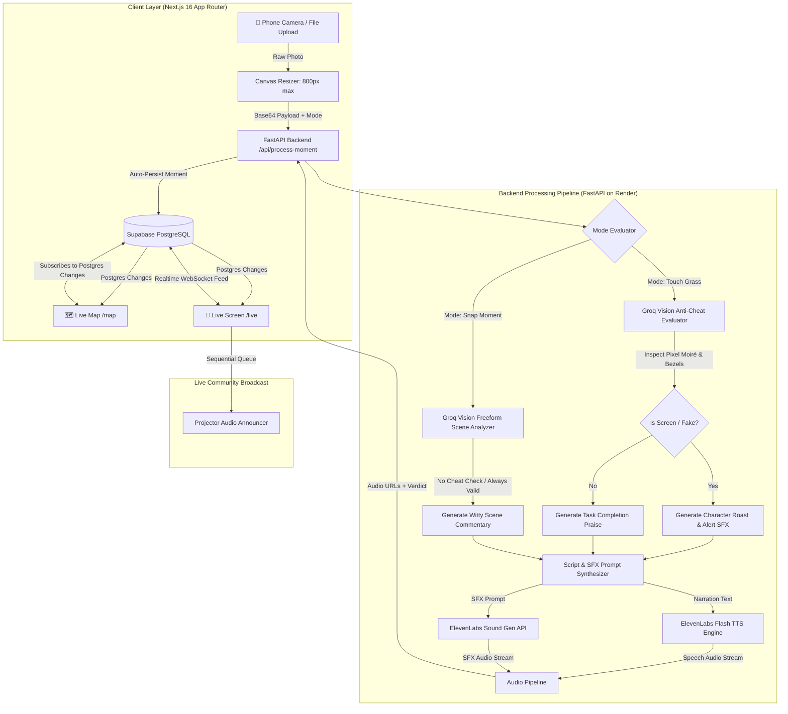

# 🛠️ TouchGrass: Technical Architecture & API Documentation

This document contains deep technical specifications, system data flows, REST API references, and database schemas for developers and judges evaluating the technical architecture of **TouchGrass**.

---

## 📐 System Data Flow



---

## 📡 REST API Reference

The backend runs on FastAPI and is deployed live at:  
👉 `https://touchgrass-r4w7.onrender.com`

### 1. Process Moment & Vision Verification
* **Endpoint:** `POST /api/process-moment`
* **Description:** Receives a base64-encoded image, runs Groq Vision inference according to the mode (`touch-grass` vs. `snap`), synthesizes dual-stream ElevenLabs voice narration and ambient SFX, and persists the record to Supabase.
* **Request Body:**
```json
{
  "image_base64": "data:image/jpeg;base64,...",
  "mode": "touch-grass",
  "quest_title": "Touch Tree Bark",
  "quest_category": "nature",
  "persona_name": "Sarang",
  "persona_style": "Funny, optimistic and inviting tone...",
  "voice_id": "EXAVITQu4vr4xnSDxMaL",
  "latitude": 28.6139,
  "longitude": 77.2090
}
```
* **Response:**
```json
{
  "caption": "Bark Whispers in the Park",
  "narration": "You stepped away from the screen and made physical contact with nature!",
  "joyCategory": "nature",
  "isCheat": false,
  "cheatReason": null,
  "speechAudioUrl": "https://fkagbunnmkejdvhazovg.supabase.co/storage/v1/object/public/...",
  "sfxAudioUrl": "https://fkagbunnmkejdvhazovg.supabase.co/storage/v1/object/public/...",
  "sfxPrompt": "wind rustling through tall autumn trees",
  "momentId": "e3b0c442-98fc-1c14-9afb-4c7b94b0af44",
  "latitude": 28.6139,
  "longitude": 77.2090
}
```

### 2. Spontaneous Task Generator
* **Endpoint:** `GET /api/generate-task`
* **Description:** Dynamically generates a spontaneous, 60-second physical offline wellness challenge using Groq LPU with localized surrounding items.
* **Response:**
```json
{
  "title": "Spot Something Bright Yellow",
  "description": "Find an everyday object, leaf, or flower around you that is bright yellow.",
  "category": "small-wins",
  "icon": "Sun"
}
```

### 3. Room Mood Synthesis (Live Finale)
* **Endpoint:** `POST /api/room-summary`
* **Description:** Queries all moments from the past 24 hours, computes category distributions, and prompts Groq + ElevenLabs to deliver an AI group mood synthesis read aloud to the room.

### 4. Demo Seeder
* **Endpoint:** `POST /api/seed-demo`
* **Description:** Seeds 4 authentic offline moments across Food, Nature, Social, and Small Wins, plus 1 screen-detected cheat moment for instant live stage demonstrations.

### 5. Health Diagnostic
* **Endpoint:** `GET /api/health`
* **Description:** Validates connectivity with Supabase, Groq API, and ElevenLabs API credentials.

---

## 🗄️ Database Schema & Storage

The database is built on **Supabase PostgreSQL** with Realtime change-data-capture (CDC) publications enabled.

```sql
-- 1. Create table for community joy moments
CREATE TABLE IF NOT EXISTS public.joy_moments (
    id UUID PRIMARY KEY DEFAULT gen_random_uuid(),
    created_at TIMESTAMPTZ DEFAULT NOW(),
    caption TEXT NOT NULL,
    narration TEXT NOT NULL,
    sfx_prompt TEXT,
    joy_category TEXT NOT NULL CHECK (joy_category IN ('nature', 'food', 'people', 'small-wins', 'cheater')),
    persona_name TEXT NOT NULL,
    image_url TEXT NOT NULL,
    speech_audio_url TEXT,
    sfx_audio_url TEXT,
    is_cheat BOOLEAN DEFAULT FALSE,
    cheat_reason TEXT,
    latitude DOUBLE PRECISION NOT NULL,
    longitude DOUBLE PRECISION NOT NULL
);

-- 2. Indexes for geo-queries and recent moment sorting
CREATE INDEX IF NOT EXISTS idx_joy_moments_created_at ON public.joy_moments (created_at DESC);
CREATE INDEX IF NOT EXISTS idx_joy_moments_coords ON public.joy_moments (latitude, longitude);

-- 3. Enable Postgres Realtime for joy_moments table
ALTER PUBLICATION supabase_realtime ADD TABLE public.joy_moments;

-- 4. Enable Row Level Security (RLS) with open read and insert for hackathon participants
ALTER TABLE public.joy_moments ENABLE ROW LEVEL SECURITY;

CREATE POLICY "Public read joy moments"
ON public.joy_moments FOR SELECT
USING (true);

CREATE POLICY "Public insert joy moments"
ON public.joy_moments FOR INSERT
WITH CHECK (true);
```

---

## 🔒 Security & Privacy Considerations
- **No Stored Facial Biometrics:** Photos are passed in-memory to Groq Vision and retained solely as polaroids on the community joy map.
- **Environment Isolation:** All secret keys (`GROQ_API_KEY`, `ELEVENLABS_API_KEY`, `SUPABASE_KEY`) are kept strictly on the backend and are never exposed to client-side bundles.
